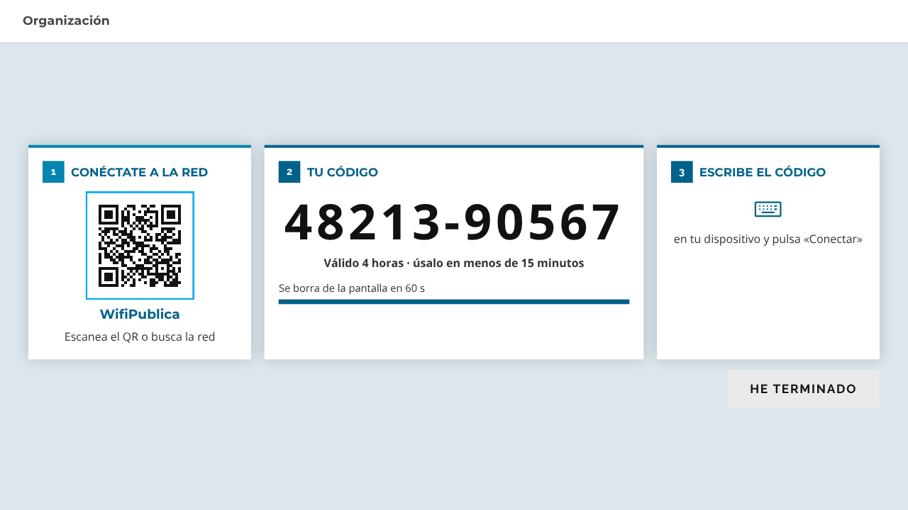
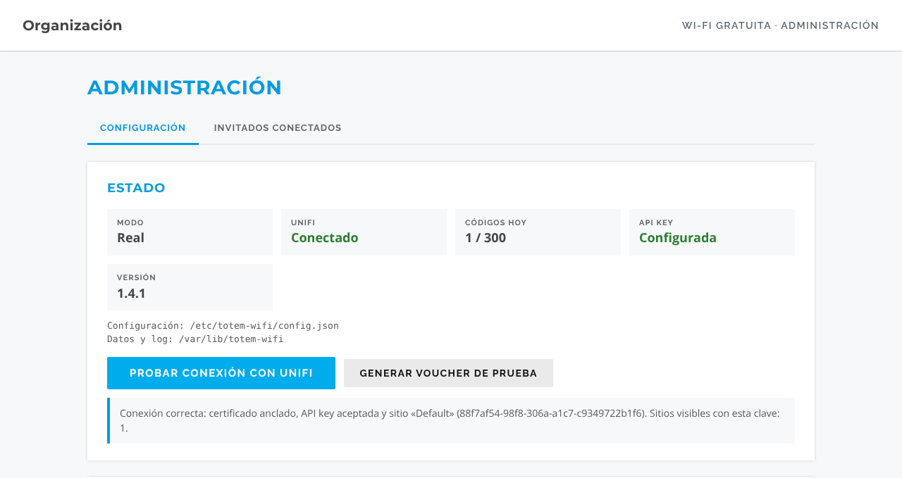
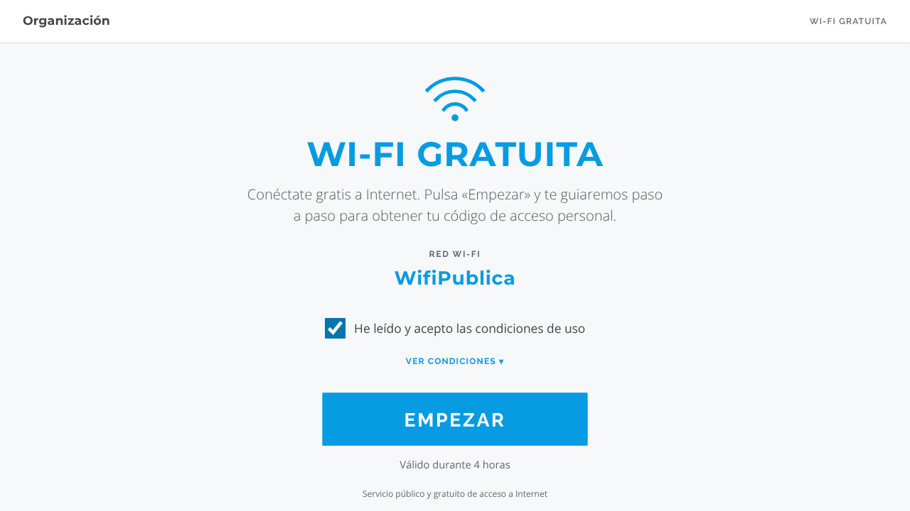
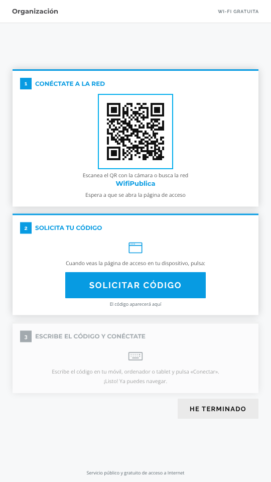
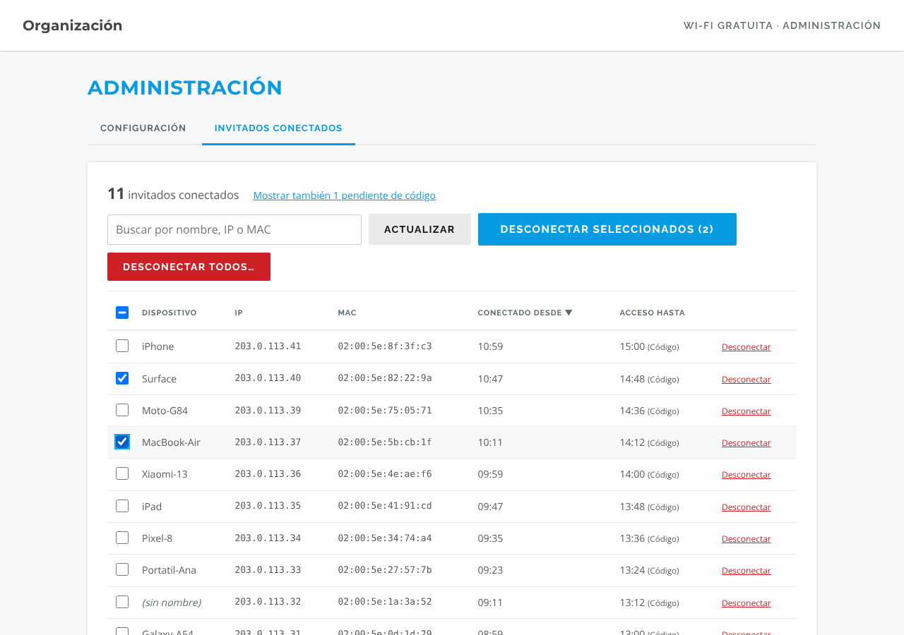

# Tótem Wi-Fi

Una aplicación que convierte cualquier pantalla con navegador en un **tótem de Wi-Fi gratuita**. El
ciudadano acepta las condiciones de uso, se conecta a la red escaneando un **QR**, pulsa **«Solicitar
código»** y recibe en pantalla un **voucher del hotspot de UniFi**, que escribe en el portal cautivo
de su móvil, ordenador o tablet.



- Es **un solo ejecutable**: no hay que instalar Python, Node, bases de datos ni nada más.
- Funciona **sin Internet**: fuentes, estilos y QR van dentro del ejecutable.
- La **API key de UniFi solo la conoce este servidor**: los tótems nunca la ven.
- Todo se configura desde **`/admin`**: servidor UniFi, red, duración y límites de los códigos,
  textos, condiciones de uso, logotipo y fondo, equipos permitidos e invitados conectados.
- Tras instalarlo arranca en **modo simulación**: da códigos falsos y muestra una franja amarilla
  «MODO PRUEBA» hasta que se configure UniFi.

---

## Índice

**Instalar**

1. [Qué hay en el paquete](#1-qué-hay-en-el-paquete)
2. [Instalación en Ubuntu Server](#2-instalación-en-ubuntu-server)
3. [Instalación en Windows (alternativa)](#3-instalación-en-windows-alternativa)
4. [Primer acceso a la administración](#4-primer-acceso-a-la-administración)
5. [Crear la API key en UniFi](#5-crear-la-api-key-en-unifi)
6. [Pasar de simulación a real](#6-pasar-de-simulación-a-real)
7. [Configurar los tótems](#7-configurar-los-tótems)

**Personalizar y usar**

8. [La pantalla del quiosco](#8-la-pantalla-del-quiosco)
9. [Textos de la pantalla y condiciones de uso](#9-textos-de-la-pantalla-y-condiciones-de-uso)
10. [Logotipo y fondo](#10-logotipo-y-fondo)
11. [Invitados conectados](#11-invitados-conectados)
12. [Caducidad de los códigos sin usar](#12-caducidad-de-los-códigos-sin-usar)

**Mantenimiento**

13. [Ver el log](#13-ver-el-log)
14. [Cambiar (rotar) la API key](#14-cambiar-rotar-la-api-key)
15. [Si UniFi cambia de certificado](#15-si-unifi-cambia-de-certificado)
16. [Diagnóstico de problemas](#16-diagnóstico-de-problemas)
17. [Actualizar a una versión nueva](#17-actualizar-a-una-versión-nueva)
18. [Desinstalar](#18-desinstalar)

**Referencia**

19. [Referencia de la configuración](#19-referencia-de-la-configuración)
20. [Línea de comandos](#20-línea-de-comandos)
21. [Para desarrolladores](#21-para-desarrolladores)
22. [Licencia](#22-licencia)

---

## 1. Qué hay en el paquete

| Paquete | Para | Contenido |
|---|---|---|
| `totem-wifi_<versión>_windows_amd64.zip` | Windows 10/11 o Windows Server de 64 bits | `totem-wifi.exe`, `install.ps1`, `uninstall.ps1`, este README |
| `totem-wifi_<versión>_linux_amd64.tar.gz` | Ubuntu/Debian en PC o servidor normal | `totem-wifi`, `install.sh`, `uninstall.sh`, este README |
| `totem-wifi_<versión>_linux_arm64.tar.gz` | Ubuntu en ARM (por ejemplo, Raspberry Pi 4/5 de 64 bits) | ídem |

`SHA256SUMS.txt` permite comprobar que el paquete ha llegado íntegro. Todos están en la página de
versiones: <https://github.com/Future-Chocolate6122/Unifi_Totem/releases>.

Dónde queda cada cosa una vez instalado:

| | Windows | Ubuntu |
|---|---|---|
| Programa | `C:\Program Files\TotemWifi\totem-wifi.exe` | `/opt/totem-wifi/totem-wifi` |
| Configuración (`config.json`) | `C:\ProgramData\TotemWifi\config.json` | `/etc/totem-wifi/config.json` |
| Contador diario (`state.json`), log y logotipo | `C:\ProgramData\TotemWifi\` | `/var/lib/totem-wifi/` |
| Nombre del servicio | `TotemWifi` | `TotemWifi` (systemd) |

> `config.json` contiene la API key y la contraseña de administración (cifrada). Los instaladores lo
> dejan legible solo por el servicio y por los administradores del equipo.

---

## 2. Instalación en Ubuntu Server

1. Descargue el paquete en el servidor. Los enlaces de la versión actual (1.4.2) son estos; para otra
   versión, cambie `1.4.2` por la que corresponda (todas están en la
   [página de versiones](https://github.com/Future-Chocolate6122/Unifi_Totem/releases)):

   ```bash
   wget https://github.com/Future-Chocolate6122/Unifi_Totem/releases/download/v1.4.2/totem-wifi_1.4.2_linux_amd64.tar.gz
   ```

   ```bash
   wget https://github.com/Future-Chocolate6122/Unifi_Totem/releases/download/v1.4.2/SHA256SUMS.txt
   ```

   Compruebe que ha llegado íntegro (debe decir `OK`):

   ```bash
   sha256sum -c --ignore-missing SHA256SUMS.txt
   ```

   En un equipo ARM (Raspberry Pi), use `linux_arm64` en lugar de `linux_amd64`.

   Si el servidor no tiene salida a Internet, descárguelo en su PC y cópielo con `scp`:

   ```bash
   scp totem-wifi_1.4.2_linux_amd64.tar.gz usuario@IP_DEL_SERVIDOR:
   ```

2. En el servidor, descomprímalo y entre en la carpeta:

   ```bash
   tar xzf totem-wifi_1.4.2_linux_amd64.tar.gz
   ```

   ```bash
   cd totem-wifi_1.4.2_linux_amd64
   ```

3. Instale indicando los datos de su red. Se pueden cambiar después en `/admin`:

   | Opción | Qué es | Ejemplo |
   |---|---|---|
   | `--unifi-url` | Dirección del UniFi OS Server | `https://192.0.2.10:11443` |
   | `--totems` | IPs o redes de los tótems, separadas por comas | `192.0.2.0/24` |
   | `--admin-ips` | IP del equipo desde el que abrirá `/admin` (su PC), separadas por comas | `192.0.2.50` |

   ```bash
   sudo ./install.sh --unifi-url https://192.0.2.10:11443 --totems 192.0.2.0/24 --admin-ips 192.0.2.50
   ```

   > **No olvide `--admin-ips`.** Por seguridad, `/admin` solo se puede abrir desde los equipos de esa
   > lista y, si no se indica, solo desde el propio servidor. En un Ubuntu Server sin escritorio no hay
   > navegador, así que sin esta opción solo podrá entrar con un túnel SSH (ver
   > [4. Primer acceso](#4-primer-acceso-a-la-administración)).

   El instalador crea el usuario de sistema `totem`, copia el programa a `/opt/totem-wifi`, crea la
   configuración, registra el servicio systemd y lo arranca. Al terminar muestra la dirección del
   quiosco y la de `/admin`.

4. Siga en [4. Primer acceso a la administración](#4-primer-acceso-a-la-administración).

Comprobar que el servicio está en marcha:

```bash
systemctl status TotemWifi
```

### Cortafuegos (ufw)

Si el servidor tiene ufw, el instalador añade un **ayudante** que mantiene el cortafuegos al día: cada
vez que se guardan en `/admin` cambios en los equipos permitidos, abre el puerto 8080 **solo** a esos
equipos. El resultado se ve en `/admin` → *Estado* → *Cortafuegos (ufw)*.

- Solo crea y borra sus propias reglas, marcadas como «Totem Wi-Fi». Nunca toca las demás (SSH queda
  a salvo) y **nunca activa ni desactiva ufw**.
- Si ufw está desactivado, deja las reglas preparadas y `/admin` lo indica. Para activarlo, permita
  antes SSH para no perder el acceso:

  ```bash
  sudo ufw allow OpenSSH
  ```

  ```bash
  sudo ufw enable
  ```

- El servicio web sigue sin privilegios: el ayudante es un servicio aparte
  (`totem-wifi-firewall`) que systemd lanza como root cuando cambia `config.json`.
- Si no quiere que se gestione ufw, instale con `--no-ufw`.

---

## 3. Instalación en Windows (alternativa)

El sistema recomendado es Ubuntu Server; esta sección es para instalarlo en Windows 10/11 o Windows
Server.

1. Copie el `.zip` al equipo y **descomprímalo** (botón derecho → *Extraer todo…*).
2. Abra **PowerShell como administrador** (menú Inicio → escriba *PowerShell* → botón derecho →
   *Ejecutar como administrador*).
3. Vaya a la carpeta descomprimida (cambie la ruta por la suya):

   ```powershell
   cd "$env:USERPROFILE\Downloads\totem-wifi_1.4.2_windows_amd64"
   ```

4. Ejecute el instalador. Copia el programa, registra el servicio, abre el puerto 8080 en el
   Firewall **solo** para los equipos permitidos, lo arranca y abre la administración en el navegador:

   ```powershell
   powershell -ExecutionPolicy Bypass -File .\install.ps1
   ```

5. Siga en [4. Primer acceso a la administración](#4-primer-acceso-a-la-administración).

Comprobar que el servicio está en marcha:

```powershell
Get-Service TotemWifi
```

> **Firewall.** En Windows la regla «Totem Wi-Fi (HTTP)» no se actualiza sola: se crea con las IPs
> que haya al instalar. Si después cambia las listas en `/admin`, vuelva a ejecutar `install.ps1`
> (conserva toda la configuración).

---

## 4. Primer acceso a la administración

La administración está en el puerto 8080 del servidor y, por seguridad, **solo se puede abrir desde
los equipos de `--admin-ips`** y desde el propio servidor (lista `admin_allowed_clients`).

- **Desde su PC** (si lo indicó en `--admin-ips`): abra `http://IP_DEL_SERVIDOR:8080/admin`.
- **Sin `--admin-ips`, en un Ubuntu sin escritorio**: abra un túnel SSH desde su PC y visite
  `http://localhost:8080/admin` en el navegador de su PC (el túnel hace que su PC «sea» el servidor, y
  además cifra la conexión):

  ```bash
  ssh -L 8080:localhost:8080 usuario@IP_DEL_SERVIDOR
  ```

- **Windows**: el instalador ya la abre en el navegador.



La primera vez pedirá **crear la contraseña** de administración (mínimo 10 caracteres). Después verá
el panel con el estado y todos los ajustes.

Para añadir o cambiar los equipos de administración más adelante, use **Acceso → Equipos que pueden
abrir /admin**. Tenga en cuenta que sin túnel la contraseña viaja sin
cifrar por la red local.

**Cambios en «Acceso».** Para cambiar los equipos permitidos o el puerto, `/admin` pide **volver a
escribir la contraseña de administración**, porque esos cambios también modifican el cortafuegos.
Tampoco deja guardar una lista de administración que excluya al equipo desde el que está conectado,
para que no se quede sin acceso.

Ajustes que conviene revisar en el primer acceso:

- **Equipos que pueden usar el quiosco**: las IPs o redes de los tótems (por defecto `127.0.0.1` y
  `192.0.2.0/24`). Un equipo que no esté en la lista recibe «Acceso no permitido».
- **Duración**, **dispositivos por código** y límites del voucher (por defecto 4 h y 1 dispositivo).
- **SSID**: por defecto `WifiPublica`. Si añade SSID adicionales, el quiosco mostrará un
  selector de red.

---

## 5. Crear la API key en UniFi

La clave se crea en el UniFi OS Server que gestiona el portal cautivo del SSID público: los vouchers
solo valen en ese servidor.

La clave tiene los mismos permisos que el usuario de UniFi que la crea. Lo recomendable es un usuario
dedicado solo al tótem, porque así se puede revocar sin afectar a nadie y en UniFi queda claro qué hizo
el tótem:

1. En UniFi OS Server, en **Admins & Users**, cree un administrador **local**, por ejemplo
   `totem-api`. No use una cuenta de ui.com. Póngale una contraseña larga.
2. Dele acceso **solo a la aplicación Network**, sin Protect, Access ni otras.
3. En Network, dele el permiso más bajo que permita **administrar** la red (suele llamarse
   «Full Management» o «Admin»). No sirven «Hotspot» ni «Solo lectura» (*View Only*): crear vouchers
   requiere permiso de escritura.
4. Entre en UniFi con ese usuario y abra **Network → Settings → Control Plane → Integrations** (en
   algunas versiones, directamente *Integrations*). Cree una clave con un nombre reconocible, por
   ejemplo «Tótem Wi-Fi», y **cópiela**: UniFi solo la muestra una vez.
5. Péguela en `/admin` (sección *UniFi OS Server*). Si «Probar conexión con UniFi» responde **403**,
   el permiso del usuario se queda corto.

Estas instrucciones también aparecen en `/admin`, bajo el campo de la clave («¿Cómo crear la clave?»).

Comprobación opcional desde cualquier equipo con `curl` (debe devolver la lista de sitios):

```bash
curl -sk -H "X-API-KEY: LA_CLAVE" https://198.51.100.20:11443/proxy/network/integration/v1/sites
```

---

## 6. Pasar de simulación a real

En `/admin`, sección **UniFi OS Server**:

1. **URL del servidor**: la del UniFi OS Server, con el formato `https://IP:11443`.
2. **API key**: pegue la clave del paso anterior.
3. Pulse **«Obtener huella del certificado»**. UniFi usa un certificado autofirmado; el programa
   guarda su huella SHA-256 y a partir de entonces **solo acepta ese certificado** (si alguien
   suplantara al servidor, no le enviaría la clave). La huella se copia sola en su campo.
   Si quiere asegurarse, compárela con la que muestra el navegador del propio servidor de UniFi
   (candado → certificado → huella SHA-256).
4. **Desmarque «Modo simulación»** y pulse **Guardar**.
5. Pulse **«Probar conexión con UniFi»**. Debe decir «Conexión correcta» y el sitio detectado
   (normalmente «Default»; se guarda solo).
6. Pulse **«Generar voucher de prueba»**: crea un voucher **real** con la nota
   «Totem (prueba admin)» que puede comprobar en UniFi (*Hotspot → Vouchers*) y borrar.

Desde la consola se puede hacer la misma comprobación, capa por capa
(Windows, en PowerShell como administrador):

```powershell
& "C:\Program Files\TotemWifi\totem-wifi.exe" check
```

Ubuntu:

```bash
sudo /opt/totem-wifi/totem-wifi check
```

`check` termina con «Todo correcto» o indica en qué capa falla (ver
[16. Diagnóstico](#16-diagnóstico-de-problemas)). No modifica la configuración.

También se puede ver la huella de un servidor sin abrir `/admin`:

```bash
totem-wifi fingerprint 198.51.100.20:11443
```

---

## 7. Configurar los tótems

En cada tótem basta un navegador Chrome o Edge en **modo quiosco** apuntando al servidor. Sustituya
`IP_SERVIDOR` por la IP del equipo donde está instalado Tótem Wi-Fi (o `localhost` si el tótem es el
propio servidor), y asegúrese de que la IP del tótem está en **Equipos que pueden usar el quiosco**.

**Windows** (cree un acceso directo en la carpeta *Inicio* del usuario del tótem con este destino):

```text
"C:\Program Files\Google\Chrome\Application\chrome.exe" --kiosk http://IP_SERVIDOR:8080/ --incognito --noerrdialogs --disable-pinch --overscroll-history-navigation=0
```

Con Edge, cambie la ruta por `"C:\Program Files (x86)\Microsoft\Edge\Application\msedge.exe"`.

**Linux con escritorio**:

```bash
chromium --kiosk http://IP_SERVIDOR:8080/ --incognito --noerrdialogs --disable-pinch --overscroll-history-navigation=0
```

---

## 8. La pantalla del quiosco



1. **Inicio**: título, red Wi-Fi y, si están activadas, las condiciones de uso con su casilla. Pulsa
   **Empezar**.
2. **Pantalla de pasos** (en horizontal, tres columnas; en vertical, uno debajo de otro):
   - **1. Conéctate a la red**: QR de la red y su nombre, por si prefiere buscarla a mano.
   - **2. Solicita tu código**: cuando ve la página de acceso en su móvil, pulsa **Solicitar
     código** y el código aparece ahí mismo, en grande, con su validez y la cuenta atrás.
   - **3. Escribe el código y conéctate**: en su móvil, ordenador o tablet.
   Si el tótem acaba de dar un código y aún no ha pasado la espera entre códigos (20 s por
   defecto), el propio botón muestra «Podrás solicitar tu código en N s» y se reactiva solo. Si no
   puede darse un código por otro motivo (límite diario, UniFi no responde), el aviso aparece en el
   paso 2 y el botón sigue disponible. Si nadie toca la pantalla en 2 minutos antes de pedir el
   código, vuelve sola al inicio.
3. Al terminar la cuenta atrás o pulsar **He terminado**, vuelve al inicio y el código desaparece.


En un tótem vertical, los tres pasos aparecen uno debajo de otro:



El código solo se genera al pulsar «Solicitar código», cuando la persona ya está conectada a la red
y viendo la página de acceso.

La pantalla bloquea el menú contextual, la selección, el zoom y el arrastre, borra el código al
terminar la cuenta atrás y **se recarga sola** cuando se guarda un cambio en `/admin` (textos,
logotipo, fondo…; lo comprueba cada minuto y solo en la pantalla de inicio, nunca con un código a la
vista) y, además, cada día a las 04:00.

---

## 9. Textos de la pantalla y condiciones de uso

En `/admin` → **Textos de la pantalla** se cambian sin tocar ficheros:

| Campo | Dónde se ve |
|---|---|
| **Título** | Texto grande de la pantalla de inicio (máx. 60 caracteres). |
| **Nombre en la cabecera** | Arriba a la derecha y en la cabecera de `/admin`. Vacío = el título. |
| **Nombre de la organización** | Arriba a la izquierda, solo si no hay logotipo. |
| **Texto de introducción** | Bajo el título (máx. 400 caracteres). Vacío = el texto por defecto. |
| **Condiciones de uso** | Texto sin formato (máx. 20 000 caracteres); deje una línea en blanco entre párrafos. |

Si marca **«Mostrar condiciones de uso antes de obtener el código»**:

- La pantalla muestra la casilla **«He leído y acepto las condiciones de uso»** y un desplegable
  **«Ver condiciones»** con el texto, que se puede desplazar con el dedo.
- **«Empezar»** queda atenuado hasta marcar la casilla; si se pulsa antes, aparece un aviso.
- Tras entregar un código, la casilla vuelve a quedar sin marcar para la siguiente persona.
- El servidor también lo comprueba: sin aceptar no entrega código.
- Cada código entregado queda en el log con la **versión** de las condiciones aceptadas
  (`condiciones_aceptadas=84a03f5a`). La versión actual se ve en `/admin` bajo el texto y cambia en
  cuanto se edita, así que se puede saber qué texto estaba vigente en cada momento.

> El portal cautivo de UniFi también puede mostrar condiciones de uso. Si ya las tiene activadas
> allí, valore si hace falta mostrarlas dos veces.

---

## 10. Logotipo y fondo

En `/admin` → **Logotipo y fondo**:

1. Pulse **Examinar / Seleccionar archivo** bajo «Logotipo» o «Foto de fondo» y elija la imagen.
2. Pulse **Subir logotipo** o **Subir fondo**. La imagen se guarda en el servidor y queda
   seleccionada en el momento; los tótems la muestran en menos de un minuto.
3. Las imágenes subidas aparecen en **Imágenes en el servidor**, con miniatura, tamaño y
   dimensiones. Para cambiar de logotipo o fondo, elíjalo en el desplegable y pulse **Guardar**.
   Las que no están en uso se pueden **borrar**.

| | Logotipo | Fondo |
|---|---|---|
| Formatos | PNG, SVG, JPG o WebP | JPG, WebP o PNG |
| Tamaño máximo | **1 MB** | **5 MB** |
| Recomendado | PNG con fondo transparente de **128 px de alto** (hasta 640 px de ancho), o SVG | **1920×1080 px** (1080×1920 si el tótem es vertical) |
| Cómo se ve | A 64 px de alto como máximo, arriba a la izquierda | Ocupa toda la pantalla (se recorta si hace falta) con una capa blanca encima para que el texto se lea |

- Se comprueba el contenido real del fichero, no solo la extensión. Los SVG con código (scripts,
  eventos o enlaces `javascript:`) se rechazan.
- Si la imagen es pequeña para su uso, se avisa al subirla (puede verse borrosa o pixelada).
- Caben hasta 30 imágenes; se guardan en `imagenes/` dentro de la carpeta de datos
  (`/var/lib/totem-wifi/imagenes/`).
- Sin logotipo se muestra el **nombre de la organización** (o nada, si está vacío).
- Las imágenes copiadas a mano en la carpeta de datos (`logo.svg` o `logo.png`), como en las
  versiones anteriores, siguen funcionando.

---

## 11. Invitados conectados



En `/admin`, la pestaña **Invitados conectados** muestra los dispositivos que han entrado por el portal
cautivo: nombre del dispositivo, IP, MAC, desde cuándo están conectados y hasta cuándo tienen acceso.

- **Buscar** por nombre, IP o MAC; **ordenar** pulsando en el título de una columna. Con más de 50
  invitados, la lista se reparte en páginas.
- **Desconectar** a uno con el enlace de su fila, o marcar varios (la casilla de la cabecera marca
  todos los que coinciden con la búsqueda) y pulsar **Desconectar seleccionados**.
- **Desconectar todos…** pide la **contraseña de administración**. Con la opción **«Invalidar también
  los códigos entregados por el tótem»** (marcada por defecto) se borran además en UniFi los códigos
  del tótem aún vigentes, para que nadie pueda volver a entrar con un código antiguo. Los códigos
  creados a mano en UniFi no se tocan.
- Por defecto no se muestran los dispositivos conectados a la red que **aún no han escrito el
  código**; el enlace «Mostrar también … pendientes de código» los añade a la lista.
- Desconectar retira el acceso del dispositivo y **no puede volver a entrar con el mismo código**
  (comprobado con «Dispositivos por código» = 1). Si ese ajuste es mayor que 1, otros dispositivos
  podrían usar las plazas que queden del código; «Desconectar todos» con la invalidación marcada
  lo evita.
- Cada desconexión queda en el log con la MAC, la IP del dispositivo y la IP del administrador.
- Si al desconectar aparece un error 403, el usuario de UniFi que creó la API key no tiene permiso
  para gestionar invitados: dele permiso de gestión en Network (ver
  [5](#5-crear-la-api-key-en-unifi)).

---

## 12. Caducidad de los códigos sin usar

La duración de un código (por ejemplo, 4 horas) empieza a contar **cuando se escribe en el portal**.
Un código que se entrega y **nadie usa no caducaría nunca**: quien lo fotografiara podría usarlo días
después. Para evitarlo, los códigos del tótem que nadie ha usado **caducan a los 15 minutos** de
generarse: la aplicación lo revisa **cada minuto** y los borra en UniFi.

- El plazo se cambia en `/admin` → *Red y voucher* → **Caducidad de los códigos sin usar
  (minutos)**; 0 lo desactiva.
- El quiosco lo avisa junto al código: «Tienes 15 minutos para usarlo; si no, caducará.»
- No afecta a quien ya está conectado ni a los códigos creados a mano en UniFi: solo se borran los
  del tótem que **nunca** se han usado.
- Cada vez que se borra alguno queda en el log
  («caducidad: borrados N códigos del tótem sin usar de más de 15 min»). Si UniFi no responde, se
  anota el error (como mucho una vez por hora) y se reintenta cada minuto.
- Elija un plazo con margen: la persona tiene que conectarse a la red, esperar el portal y escribir
  el código. Menos de 10 minutos puede dejar fuera a quien tarde.

---

## 13. Ver el log

Se escribe una línea por cada voucher (IP del tótem, código **enmascarado** `*****-67890`, SSID y
minutos), por cada error de UniFi y por cada acción de administración. La API key **nunca** se
escribe en el log.

El fichero `totem-wifi.log` está en la carpeta de datos y rota solo (5 ficheros de 5 MB).

Windows, ver las últimas líneas y seguir en directo:

```powershell
Get-Content "C:\ProgramData\TotemWifi\totem-wifi.log" -Tail 50 -Wait
```

Ubuntu:

```bash
journalctl -u TotemWifi -f
```

Estado rápido (sirve para monitorización; responde 503 si UniFi no contesta):

```bash
curl http://localhost:8080/healthz
```

```json
{"ok":true,"mock":false,"unifi":"ok","daily_used":12}
```

---

## 14. Cambiar (rotar) la API key

1. En UniFi (*Network → Settings → Control Plane → Integrations*) cree una clave **nueva**.
2. En `/admin`, pegue la nueva en **API key** y pulse **Guardar**.
3. Pulse **«Probar conexión con UniFi»** y compruebe que dice «Conexión correcta».
4. Vuelva a UniFi y **borre la clave antigua**.

El cambio es inmediato: no hace falta reiniciar el servicio.

---

## 15. Si UniFi cambia de certificado

Si UniFi OS Server se reinstala o renueva su certificado, el quiosco dirá «Ahora mismo no podemos darte
un código…» y el log mostrará:

```text
huella del certificado distinta: ¿se ha regenerado el certificado de UniFi?
```

Si el cambio es legítimo: `/admin` → **«Obtener huella del certificado»** → **Guardar** →
**«Probar conexión con UniFi»**.

---

## 16. Diagnóstico de problemas

Con UniFi, vaya **por capas**, en este orden (`totem-wifi check` y «Probar conexión con UniFi» indican la capa). Las últimas filas recogen otros problemas frecuentes:

| Capa | Síntoma | Qué hacer |
|---|---|---|
| **Conexión TCP** | «No hay conexión con https://…:11443» | ¿Es correcta la IP? ¿Está encendido UniFi OS Server? ¿Algún cortafuegos bloquea el puerto 11443 entre este servidor y UniFi? Pruebe `Test-NetConnection 198.51.100.20 -Port 11443` (Windows) o `nc -vz 198.51.100.20 11443` (Ubuntu). |
| **Certificado** | «huella del certificado distinta» | Ver [15](#15-si-unifi-cambia-de-certificado). |
| **Clave / rol** | HTTP 401 | Clave mal copiada o borrada en UniFi: cree otra. |
| | HTTP 403 | El usuario que creó la clave no tiene permisos suficientes: ver [5](#5-crear-la-api-key-en-unifi) (hace falta permiso de gestión en Network; «Hotspot» y «Solo lectura» no bastan). También pasa si la clave es de **otro** servidor. |
| **Sitio** | HTTP 404 o «no se encuentra el sitio default» | Deje vacío **ID del sitio** y pulse «Probar conexión» para detectarlo. |
| **Parámetros del voucher** | HTTP 400 | Revise duración (1–1 000 000 min) y velocidades (0 o 2–100 000 kbps). |
| **Acceso al quiosco** | El tótem muestra «Acceso no permitido desde este equipo» | Su IP no está en *Equipos que pueden usar el quiosco*. En el log aparece `acceso denegado … desde IP`. |
| | El tótem no carga la página | En Ubuntu, compruebe en `/admin` → *Estado* → *Cortafuegos (ufw)* que la red del tótem aparece en la lista. Si se queda en «Aplicando…» o da error, mire el ayudante con `systemctl status totem-wifi-firewall` y sincronice a mano con `sudo /opt/totem-wifi/totem-wifi firewall-sync` (muestra qué reglas añade o quita). En Windows, compruebe que la regla «Totem Wi-Fi (HTTP)» del Firewall incluye la IP del tótem (vuelva a ejecutar `install.ps1`). |
| **Límites** | El botón muestra «Podrás solicitar tu código en N s» | Es la espera entre códigos contra abusos (`cooldown_seconds`, 20 s por tótem). Se reactiva solo. |
| | «Hoy ya se han entregado todos los códigos disponibles» | Se ha alcanzado `daily_limit` (300). El contador vuelve a cero a medianoche. |
| **Administración** | Ha olvidado la contraseña | Pare el servicio, edite `config.json` como administrador, deje `"admin_password_hash": ""`, arranque el servicio y abra `/admin` desde un equipo de *Equipos que pueden abrir /admin* para crear una nueva. |

---

## 17. Actualizar a una versión nueva

Las novedades de cada versión están en [`CHANGELOG.md`](CHANGELOG.md).

Descargue y descomprima el paquete nuevo como en los pasos 1 y 2 de
[2. Instalación en Ubuntu Server](#2-instalación-en-ubuntu-server) (cambie el número de versión en los
enlaces) y ejecute **el mismo instalador** que la primera vez. Para el servicio, sustituye el programa
y lo vuelve a arrancar **conservando la configuración y el contador**.

El instalador guarda antes una copia de la configuración en `config.json.bak`, junto a `config.json`.
Las versiones nuevas pueden añadir campos que una versión anterior no reconoce: si tuviera que volver
atrás, instale la versión anterior y restaure esa copia.

Windows (PowerShell como administrador, en la carpeta del paquete nuevo):

```powershell
powershell -ExecutionPolicy Bypass -File .\install.ps1 -NoBrowser
```

Ubuntu (no hace falta repetir las opciones de instalación: la configuración se conserva):

```bash
sudo ./install.sh
```

Los tótems recogen la versión nueva en la recarga de las 04:00 (o al reiniciar el navegador).

---

## 18. Desinstalar

Quita el servicio, el ayudante y las reglas «Totem Wi-Fi» del cortafuegos, y el programa. La configuración y los datos se conservan
salvo que se indique lo contrario.

Windows:

```powershell
powershell -ExecutionPolicy Bypass -File .\uninstall.ps1
```

Windows, borrando también configuración, contador y log:

```powershell
powershell -ExecutionPolicy Bypass -File .\uninstall.ps1 -Purge
```

Ubuntu:

```bash
sudo ./uninstall.sh
```

Ubuntu, borrando también configuración, datos y el usuario `totem`:

```bash
sudo ./uninstall.sh --purge
```

---

## 19. Referencia de la configuración

Todo se puede cambiar desde `/admin`. Si edita `config.json` a mano, pare antes el servicio y
arránquelo después; un campo mal escrito impide arrancar y el error dice cuál es.

| Campo | Por defecto | Significado |
|---|---|---|
| `listen` | `0.0.0.0:8080` | Dirección y puerto de escucha (cambiarlo requiere reiniciar). |
| `allowed_clients` | `127.0.0.1`, `192.0.2.0/24` | IPs o redes CIDR que pueden usar el quiosco. El propio equipo siempre puede. |
| `admin_password_hash` | vacío | Contraseña de `/admin` cifrada con bcrypt. Vacío = se crea en el primer acceso. |
| `admin_allowed_clients` | `127.0.0.1` | IPs o redes que pueden abrir `/admin`. |
| `unifi.base_url` | `https://198.51.100.20:11443` | Dirección del UniFi OS Server (IP de ejemplo). |
| `unifi.api_key` | vacío | Clave de la Integration API. Nunca se muestra ni se registra. |
| `unifi.site_id` | vacío | Sitio de UniFi. Vacío = se detecta el «default» y se guarda. |
| `unifi.cert_sha256` | vacío | Huella anclada del certificado. Vacío = no se conecta (salvo simulación). |
| `unifi.mock` | `true` | Modo simulación: códigos falsos y franja «MODO PRUEBA». |
| `voucher.ssid` | `WifiPublica` | Red que se muestra y se codifica en el QR. |
| `voucher.ssid_password` | vacío | Contraseña Wi-Fi para el QR. Vacío = red abierta con portal. |
| `voucher.extra_ssids` | `[]` | Redes adicionales `{"ssid": "...", "password": "..."}`; si hay alguna, el quiosco muestra un selector. |
| `voucher.note` | `Totem` | Nota del voucher visible en UniFi (útil para saber de qué tótem sale). |
| `voucher.minutes` | `240` | Duración del voucher (1–1 000 000). |
| `voucher.guest_limit` | `1` | Dispositivos por código (0 = sin límite). |
| `voucher.unused_expire_minutes` | `15` | Minutos tras los que caduca un código del tótem que nadie ha usado (0 = no caducan; máx. 10080). |
| `voucher.data_mb` | `0` | Límite de datos en MB (0 = sin límite; máximo 1 048 576, el que admite UniFi). |
| `voucher.rx_kbps` / `tx_kbps` | `0` | Velocidad de bajada / subida (0 = sin límite; si no, 2–100 000). |
| `kiosk.title` | `Wi-Fi gratuita` | Título de la pantalla. |
| `kiosk.organization` | vacío | Nombre de la organización, en la cabecera cuando no hay logo. |
| `kiosk.header_text` | vacío | Nombre del servicio en la cabecera (vacío = el título). |
| `kiosk.intro` | vacío | Texto de introducción (vacío = el texto por defecto del idioma). |
| `kiosk.terms_enabled` | `false` | Pedir que se acepten las condiciones de uso antes de dar el código. |
| `kiosk.terms_text` | vacío | Texto de las condiciones de uso (obligatorio si `terms_enabled` es `true`). |
| `kiosk.display_seconds` | `60` | Segundos que el código permanece en pantalla. |
| `kiosk.cooldown_seconds` | `20` | Espera mínima entre códigos para un mismo tótem. |
| `kiosk.daily_limit` | `300` | Máximo de códigos al día entre todos los tótems (se reinicia a medianoche). |
| `kiosk.language` | `es` | Idioma de la pantalla. |
| `kiosk.logo_path` | vacío | Imagen del logotipo, elegida en `/admin` (vacío = `logo.svg` o `logo.png` copiado a mano, si existe). |
| `kiosk.background_image` | vacío | Imagen de fondo, elegida en `/admin` (vacío = sin fondo). |

**Otro idioma**: copie `internal/i18n/es.json` del código fuente como, por ejemplo, `en.json` en una
carpeta `i18n` dentro de la carpeta de datos, traduzca los textos y elíjalo en **Quiosco → Idioma**.
Las frases que falten se muestran en castellano.

---

## 20. Línea de comandos

```text
totem-wifi                       ejecuta en primer plano (pruebas)
totem-wifi -config RUTA          usa otro config.json (y su carpeta para los datos)
totem-wifi -data DIR             carpeta de datos (state.json, log, logo)
totem-wifi install | uninstall | start | stop | restart | status
                                 gestiona el servicio (como administrador / root)
totem-wifi fingerprint HOST:PUERTO
                                 muestra la huella SHA-256 del certificado de un servidor
totem-wifi check                 prueba la configuración y UniFi por capas (sale con ≠0 si falla)
totem-wifi init                  crea config.json con los valores por defecto si no existe
totem-wifi set [-unifi-url URL] [-totems LISTA] [-admin-ips LISTA]
                                 ajusta UniFi, tótems y administración (lo usa install.sh; reinicie después)
totem-wifi firewall-sync         ajusta ufw a los equipos permitidos (root; lo lanza systemd solo)
totem-wifi allowlist             puerto e IPs permitidas
totem-wifi version               versión
```

Sin `-config`, el programa usa `config.json` junto al ejecutable si existe; si no, el del servicio
instalado (`C:\ProgramData\TotemWifi\` o `/etc/totem-wifi/`).

---

## 21. Para desarrolladores

Requisitos: Go 1.23 o superior y `make` (los paquetes se generan con `zip`, `tar` y `sha256sum`).
Sin CGO: todo compila de forma cruzada desde cualquier sistema.

```bash
make test        # pruebas
make vet         # go vet (y staticcheck si está instalado)
make run         # arranca en modo desarrollo con ./dev/config.json → http://localhost:8080/
make build       # binario para esta plataforma
make build-all   # dist/ para windows/amd64, linux/amd64 y linux/arm64
make release     # paquetes .zip y .tar.gz en dist/, que son lo que se copia al servidor
```

Estructura: `cmd/totem-wifi` (arranque, comandos y servicio del sistema), `internal/config`,
`internal/unifi` (cliente de la Integration API con anclaje del certificado y cliente simulado),
`internal/voucher` (cooldown, límite diario, formato del código), `internal/web` (servidor, quiosco
y administración; los estáticos van embebidos), `internal/i18n` (textos) y `deploy/` (instaladores).

---

## 22. Licencia

Tótem Wi-Fi se distribuye bajo la **licencia MIT** (fichero [`LICENSE`](LICENSE)): se puede usar,
copiar, modificar y redistribuir libremente, conservando el aviso de copyright.

El ejecutable incluye componentes de terceros (la biblioteca estándar de Go, `go-qrcode`,
`kardianos/service` y `x/crypto`) y las fuentes Montserrat, Raleway y Open Sans (SIL Open Font
License 1.1). Sus licencias están en la carpeta [`licencias/`](licencias/LEEME.md) del repositorio y
de cada paquete.
